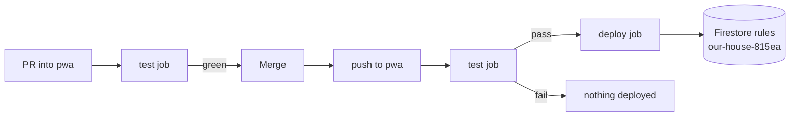

# Firestore security rules

`firestore.rules` in this repo is the **only** rule set for the shared Firebase
project `our-house-815ea`. Firestore has a single rule set per database, so this
file is the security perimeter for all four household apps (our-house, our-menu,
smart-grocery, control-gastos). No other repo deploys rules; a partial deploy
from anywhere else would overwrite this one.

Since #14, the rules deploy **automatically from CI** when a change merges to
`pwa`, and only after the emulator test suite passes. Nobody deploys them by
hand.

---

## 1. How the rules work

### Deny by default

The first match block denies every read and write on every path. Access exists
only where a later block explicitly allows it, so a new collection is
**unreadable and unwritable until it is added here**. That is intended, and it
is why control-gastos could not write `gastos_ubicaciones` until #15.

### Identity comes from `users/{uid}`

Rules never trust what the client says about itself. Every check looks up the
caller's own profile document, `users/{request.auth.uid}`:

| Field | Meaning |
| --- | --- |
| `householdId` | The household the user belongs to (`null` until they create or join one). |
| `role` | `'admin'` (created the household) or `'member'`. |
| `canAccessGastos` | Optional flag; grants a non-admin member access to control-gastos data. |

### Helper functions

| Helper | True when |
| --- | --- |
| `isMember(hid)` | Caller is signed in and their profile's `householdId == hid`. |
| `isAdmin(hid)` | `isMember(hid)` and their `role == 'admin'`. |
| `hasGastosAccess(hid)` | `isMember(hid)` and (admin **or** `canAccessGastos == true`). |
| `isValid*(data)` | The document has the required fields with the right types (see below). |

Validators use `hasAll` for required fields, so **extra fields are allowed**.
That is what lets schemas evolve additively (for example smart-grocery's
`GroceryList` contract) without touching the rules.

### Access by collection

| Path | Read | Write | Notes |
| --- | --- | --- | --- |
| `users/{uid}` | Self, or anyone in the same household | See below | Exposes only uid/email/role/householdId. |
| `households/{hid}` | Members | Create: anyone signed in, as `createdBy` themselves. Update/delete: admin | |
| `invites/{CODE}` | `get` by any signed-in user; **no `list`** | Create/update: members, only under the household's real `inviteCode`, only `{ householdId }`. Delete: admin | Codes can't be enumerated; knowing one is what grants the lookup. |
| `households/{hid}/people`, `/chores` | Members | Members; `isValidPerson` / `isValidChore`; `id` can't change | our-house |
| `households/{hid}/menu_ingredients`, `/menu_dishes`, `/menu_week_plans` | Members | Members; validated; `id` can't change | our-menu |
| `households/{hid}/grocery_lists` | Members | Members; `isValidGroceryList`; `id` can't change | Written by our-menu, owned by smart-grocery |
| `households/{hid}/gastos_*` (12 collections + `gastos_ubicaciones`) | `hasGastosAccess` | `hasGastosAccess` | control-gastos; no per-collection validation |
| `households/{hid}/gastos_inbox` | Admin only | **Nobody** | Written only by the ingestion Apps Script service account, which bypasses rules. |

### How profiles are protected (`users/{uid}`)

This block stops users from giving themselves privileges:

- **Create:** only your own document, and only with `role: 'member'` and
  `householdId: null`. No client can sign up as an admin.
- **Update (self):** either a normal edit that changes neither `role` nor
  `householdId`, **or** a one-time household assignment from `householdId: null`:
  - becoming `admin` only for a household whose `createdBy` is you;
  - becoming `member` of any existing household.
- **Update (admin):** an admin may change **only** `canAccessGastos` on a
  member of their household (control-gastos → Ajustes → Miembros).

### Known caveats

- **Joining is not tied to the invite code in the rules.** A user without a
  household can set `householdId` to any *existing* household as `member`; the
  invite-code check lives in application logic. Household IDs are random, which
  limits this, but it is a rules-level gap. Tracked in
  [#18](https://github.com/angutierrezdev/our-house/issues/18).
- **Users without a household can read each other's profiles.** The read rule
  calls `isMember(resource.data.householdId)`; when both profiles have
  `householdId: null` the comparison `null == null` is true. Tracked in
  [#19](https://github.com/angutierrezdev/our-house/issues/19).
- **gastos collections have no shape validation** — any `hasGastosAccess` user
  can write any fields.

---

## 2. Changing the rules

1. Branch off `pwa` (never `main`).
2. Edit `firestore.rules`. For a new household-scoped collection, add a match
   block beside its siblings using the same helper, for example:

   ```
   match /households/{householdId}/gastos_nueva/{docId} {
     allow read, write: if hasGastosAccess(householdId);
   }
   ```

3. Add cases to `tests/rules/firestore.spec.ts`. At minimum: the allowed user
   succeeds, a member without the access is denied, and **another household is
   denied** (the tenant boundary). Fixtures: `alice` (admin of `h1`), `bob`
   (member of `h1`, no gastos flag), `carol` (member of `h2`), `dave` (no
   household).
4. Run locally: `npm run test:rules` (needs Java and the Firebase CLI).
5. Open a PR into `pwa`. The workflow runs the suite on the PR; merge when green.

---

## 3. Automatic deployment

Workflow: [`.github/workflows/firestore-rules.yml`](../.github/workflows/firestore-rules.yml).



### When it runs

On a pull request into `pwa`, a push to `pwa`, or a manual run — **but only if
the change touches** one of:

- `firestore.rules`
- `firebase.json`
- `tests/rules/**`
- `.github/workflows/firestore-rules.yml`

Changes to app code don't trigger it (that's `deploy.yml`, which publishes the
app to GitHub Pages).

### Job 1 — `test` (the gate)

1. Installs Java 17 (Temurin). The Firestore emulator needs it; without Java
   the gate would stop being a gate.
2. `npm ci`, then installs `firebase-tools` pinned to the same version used
   locally (`FIREBASE_TOOLS_VERSION`).
3. Runs `npm run test:rules`, which is
   `firebase emulators:exec --only firestore "vitest run tests/rules"`.

### Job 2 — `deploy`

- Runs only after `test` passes, only on `pwa`, and **never on a PR**.
- Authenticates with the service-account key in `FIREBASE_RULES_DEPLOYER_KEY`.
- Runs `firebase deploy --only firestore:rules --project our-house-815ea`.
  Only the rules are deployed — not indexes, Hosting, or anything else.

### The credential

This is the most sensitive credential in the household setup: it can rewrite
the security perimeter of every app and every household. It is kept narrow on
purpose:

| Layer | Restriction |
| --- | --- |
| Service account | `firestore-rules-deployer@our-house-815ea.iam.gserviceaccount.com` |
| IAM roles | **Firebase Rules Admin** + **Service Usage Consumer** only — no data, Auth, or Hosting access |
| Secret | `FIREBASE_RULES_DEPLOYER_KEY`, stored in the GitHub **environment** `firestore-rules`, not as a repo-wide secret |
| Environment | Deployment branches limited to `pwa`, so no other branch's workflow can read the key |

---

## 4. Operations

**Check what's live.** The latest successful run of *Firestore rules* on `pwa`
(GitHub → Actions) shows the commit that was released; the deploy log ends with
`released rules firestore.rules to cloud.firestore`. The Firebase console
(Firestore → Rules) also keeps a history of releases.

**Redeploy without changes.** Actions → *Firestore rules* → *Run workflow* on
`pwa`.

**Roll back.** Revert the offending PR into `pwa`. The revert touches
`firestore.rules`, so the workflow tests and deploys the previous version. Avoid
rolling back from the Firebase console: git would then disagree with what's
live, and the next deploy would overwrite the console change.

**Rotate the key.** In Google Cloud → IAM → Service accounts →
`firestore-rules-deployer` → Keys: add a new JSON key, then
`gh secret set FIREBASE_RULES_DEPLOYER_KEY --env firestore-rules < key.json`,
delete the local file, and delete the old key in the console. Trigger a manual
run to confirm it works.

**If the run fails:**

| Failing step | Likely cause |
| --- | --- |
| `test` | A rules change broke an existing case, or a new case is wrong. Nothing was deployed. |
| `Authenticate to Google Cloud` | Secret missing, revoked, or the run isn't on `pwa` (environment policy). |
| `Deploy Firestore rules` with `PERMISSION_DENIED` | The service account is missing a role; the error names the permission. |
